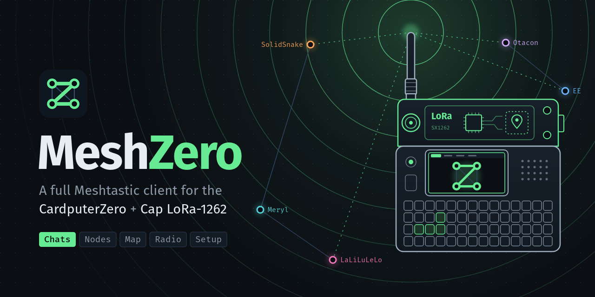
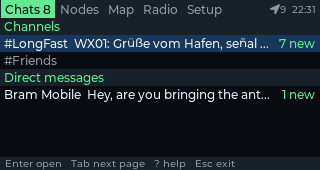
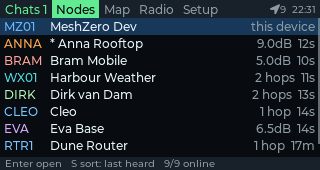

# MeshZero



A Meshtastic client for the M5Stack CardputerZero with the Cap LoRa-1262.

The Cardputer Zero needed a fully featured meshtastic client, but the only
available app was their built in LoRa app, which is a basic implementation.
The goal with this project was to implement everything that the meshtastid
daemon supports, and bring the Cardputer up with full Meshtastic support.

My long term goal is to expand the app's abilities into Meshcore and potentially
other mesh networking technologies.

## A little taste...

  

## What it does

- Channel chat and DMs with delivery status and unread counts.
- Tapbacks, replies and emoji: react to any message, answer one in
  particular, pick emoji from a grid while writing.
- Message details (signal, hops, encryption, delivery) and sending a failed
  message again.
- Background service keeps meshtastic running even when off app.
- Node listing with details, actions, and all supported functions.
- A simple radar-style map of the nodes around you.
- A radio page with link state, counters, GPS fix and a live packet log.
- Settings for most of what the phone apps cover: region, modem preset,
  channels and keys (add by URL or by scanning a QR code with the camera,
  share by QR), custom modem settings, node name and role, position,
  power, network, security, MQTT, telemetry and a few other modules.
- The Meshtastic TCP API on port 4403, for MeshMonitor, the `meshtastic` CLI
  or the phone apps over Wi-Fi. Enable that in settings.

## You need

- CardputerZero on the official 64-bit Debian 13 image.
- Cap LoRa-1262 with an appropriate antenna for your region.


> [!IMPORTANT]
> Power the device off before you attach or remove the cap. It is not
hotswappable and can cause damage. Avoid using without an antenna attached.


## Install

### Store Install

Get it directly from the built-in store: [MeshZero on Cardputer.cc](https://cardputer.cc/#/apps/MSH0) 

### APT

```sh
sudo apt install ./meshzero_<version>_arm64.deb
```

### DPKG
Install the dependencies first:

```sh
sudo apt install adduser libgpiod3 libi2c0 libinput10 liborcania2.3 libsdl2-2.0-0 libssl3t64 libulfius2.7t64 libusb-1.0-0 libuv1t64 libx11-6 libxkbcommon0 libyaml-cpp0.8
```

then install:
``` sh
sudo dpkg -i ./meshzero_<version>_arm64.deb
```

## Meshes with their own radio settings

Some local meshes do not use one of the official modem presets. A channel
link or QR code from such a mesh carries its radio settings too. When you add
one (Setup > Channels > Add from URL or Scan QR code) and the settings differ
from yours, MeshZero asks whether to add only the channels or to switch to
that setup, which replaces your channels and radio settings the way the phone
apps do.

Setup > Channels > Community setups lists a few such setups so they can be
chosen without a link. This is experimental: it is new, and how it works may
still change. They are not official Meshtastic presets, and a node using one
only reaches nodes set up the same way. So far:

- SFNarrow (Spain): EU_868, SF7, 62.5 kHz, CR 4/5, 869.618 MHz. From
  [meshtastic.es](https://meshtastic.es/docs/generador-configuracion/).

The same values can be entered by hand under Setup > LoRa radio: change the
bandwidth, spreading factor or coding rate and the modem becomes Custom. A
fixed frequency can be set there too.

## Updates

When it starts, and at most once an hour, MeshZero asks GitHub which release
is the latest and tells you if yours is older. Nothing about you or your node
is sent, only the request itself. It needs `curl` and a network, and does
nothing without them. Turn it off under Setup > Updates, or set
`MESHZERO_UPDATE_CHECK=0`. Installing the update is still up to you, from the
store or the releases page.

## Keys

| Key | What it does |
| --- | --- |
| Arrows (F, X, Z, C) | Move and scroll. No Fn needed, except while typing text |
| Enter | Open, edit, send |
| Up, in a chat | Pick a message. Up and Down move between messages, Enter offers what to do with it: react, reply, details, send again |
| Tab, in a chat | Emoji to put into the message being written |
| Esc | Back. On a changed settings page it asks whether to save. On the main pages, hold it for 2 seconds to leave the app |
| Tab, Left, Right | Switch between Chats, Nodes, Map, Radio and Setup |
| + and - | Zoom the map, 0 to fit everything |
| ? | Help |

## Running in the background

The radio stays on after you close the app, so messages keep arriving and your
node keeps relaying. While it runs it owns the LoRa cap and the GPS, so other
apps can't use them. To free the cap, turn off Setup > Run in background. The
radio then starts when you open MeshZero and stops about ten seconds after you
close it.

Without the cap attached the radio does not run at all. It starts once a cap
is found or the app is opened.

## Using it from other software

Turn on Setup > Network access first. It is off by default. The Radio page
then shows the device's IP address. Point a Meshtastic TCP client at it on
port 4403:

```sh
meshtastic --host 192.168.1.50 --info
```

For MeshMonitor, set `MESHTASTIC_NODE_IP` to that address.
The API has no authentication, same as any Meshtastic node with networking
turned on, so while network access is on anyone on your network can use the
radio.

## Building

On a desktop, for development:

```sh
cmake -S . -B build/host -G Ninja      # add -DMESHZERO_SDL=ON for a window (needs libsdl2-dev)
cmake --build build/host
ctest --test-dir build/host            # the proxy test also wants: pip install meshtastic
```

You don't need the hardware to work on it. `tools/fakeradio.py` pretends to be
a radio with a handful of nodes:

```sh
pip install meshtastic
python3 tools/fakeradio.py &
MESHZERO_STATE_DIR=/tmp/mz build/host/meshzerod serve &
MESHZERO_STATE_DIR=/tmp/mz build/host/meshzero --display sdl
```

The camera can be stood in for as well. `MESHZERO_CAMERA_CMD` names a program
that writes raw 1920x1080 YUV 4:2:0 frames, for example a still image through
ffmpeg:

```sh
export MESHZERO_CAMERA_CMD="ffmpeg -loglevel quiet -re -loop 1 -i code.png \
  -vf scale=300:300,pad=1920:1080:-1:-1:gray -pix_fmt yuv420p -r 10 -f rawvideo -"
```

`meshzero --script FILE` runs the interface with no display and saves
screenshots. That is how the ones in `screenshots/` are made, see
`tools/uitest.sh`.

The arm64 package is cross-built in Docker:

```sh
packaging/build-deb.sh                 # writes dist/meshzero_<version>_arm64.deb
```

## License

GPL-3.0-only. See [LICENSE](LICENSE) and
[THIRD_PARTY_NOTICES.md](THIRD_PARTY_NOTICES.md).
